<div align="center">

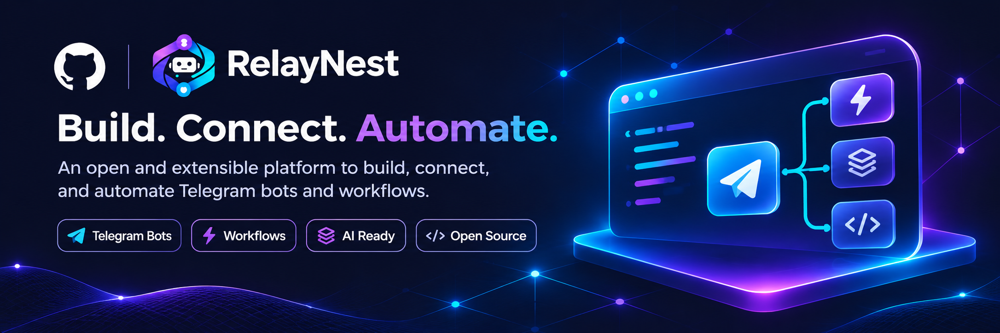

# RelayNest

**Build Telegram Bots. Automate Workflows. Launch Grounded AI Agents.**

A multi-tenant no-code Telegram bot builder, visual automation studio, RAG Knowledge Base, and workspace API platform — backed by Supabase (Auth, Postgres RLS, Storage), Telegram Bot API, Upstash Redis &amp; Kafka, NVIDIA Build / Vercel AI Gateway, Razorpay (USD &amp; INR/UPI QR), and Brevo.

[](https://github.com/Ishan96Dev/relaynest/actions/workflows/ci.yml)


[](LICENSE)

</div>

---

## Product Tour (Live Workspace Walkthroughs)

Explore real recorded walkthroughs captured from the live RelayNest workspace (zero mock overlays):

| Overview & Notifications | My Bots & Two-Way Sync |
| :---: | :---: |
| 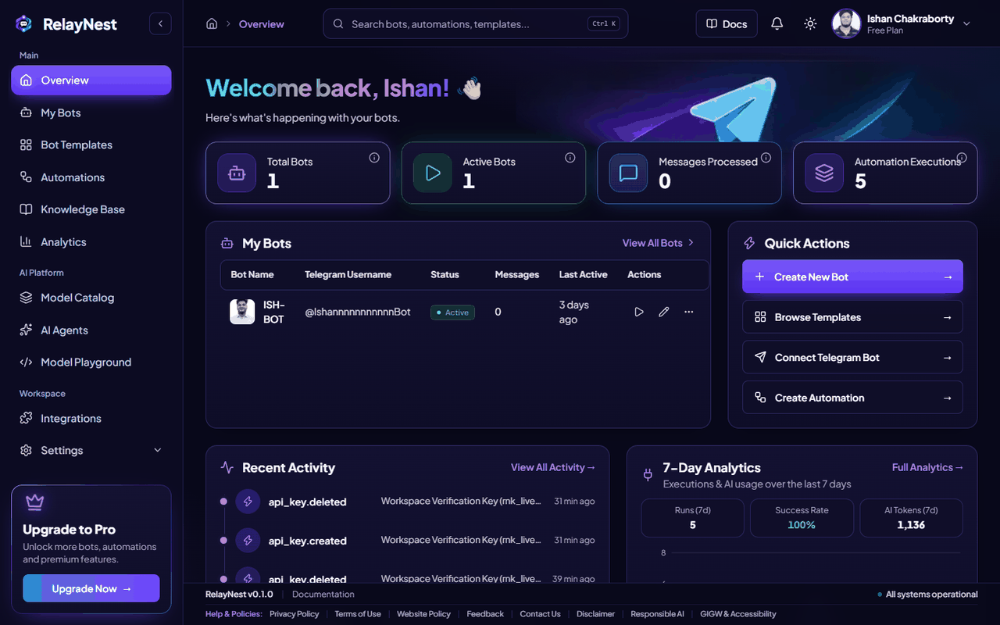 | 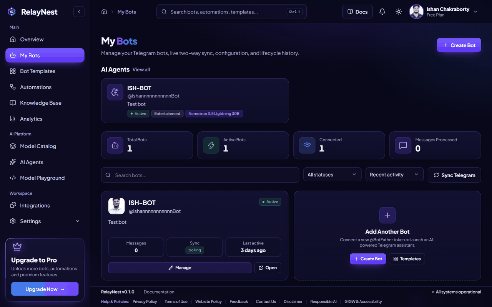 |
| **Visual Automations & Flows** | **Manage & Edit Bot** |
| 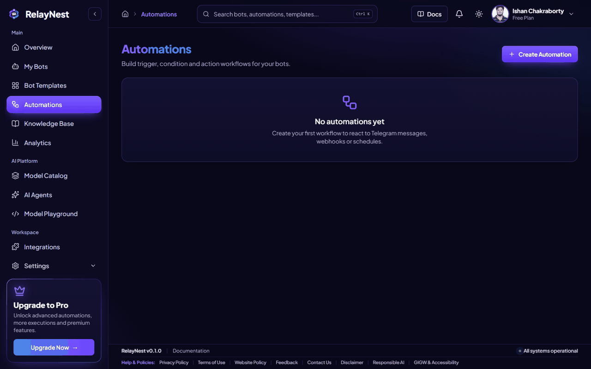 | 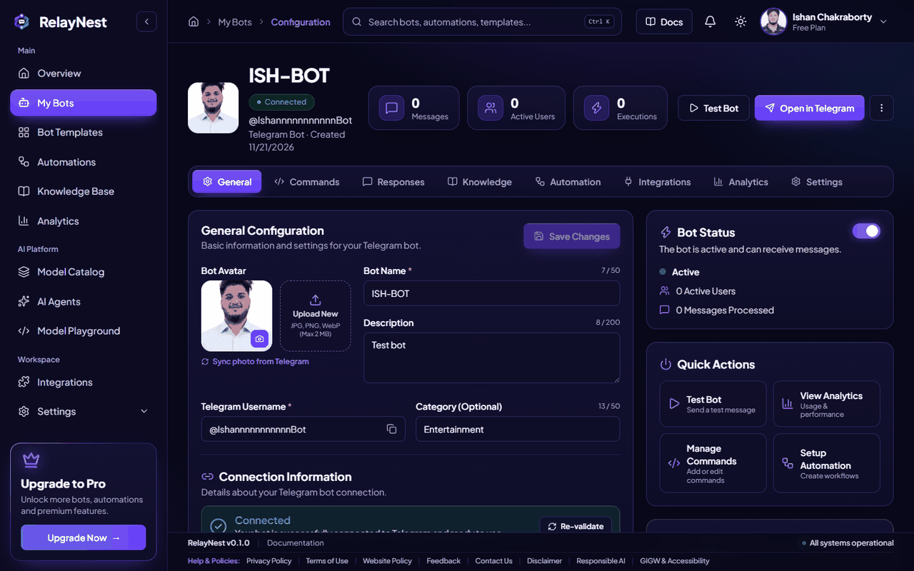 |
| **Knowledge Base & AI Agents** | **Integrations & Signed Webhooks** |
| 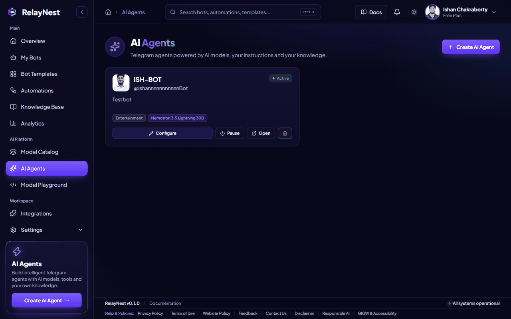 | 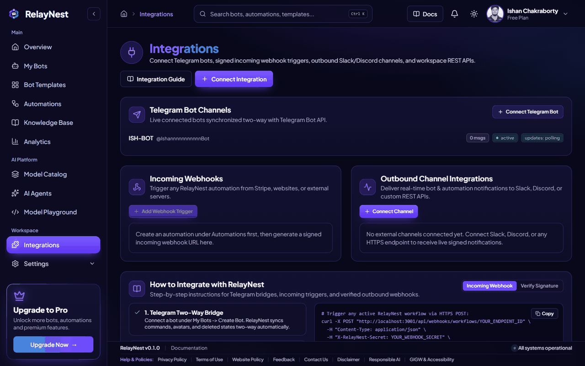 |
| **Scoped API Keys & In-App Swagger UI** | **Compliance, Settings & Billing** |
| 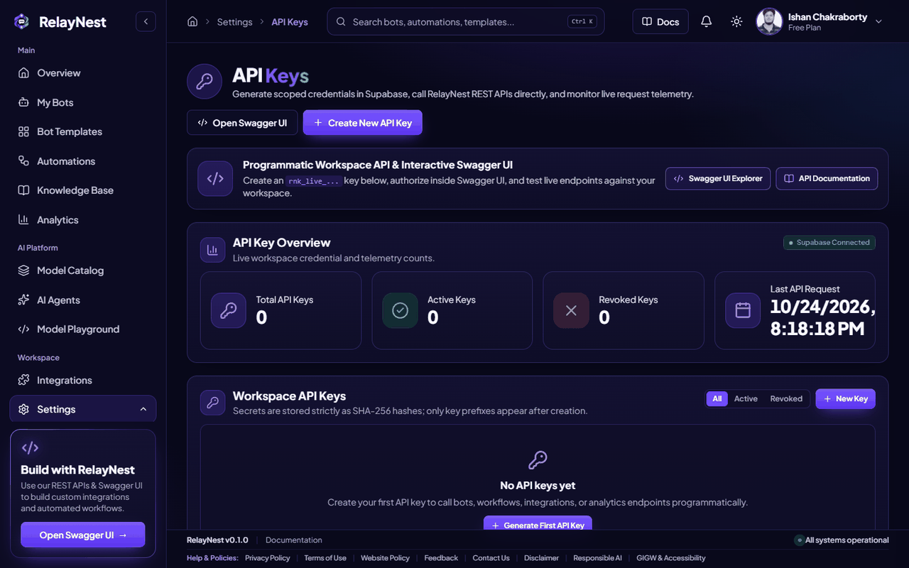 | 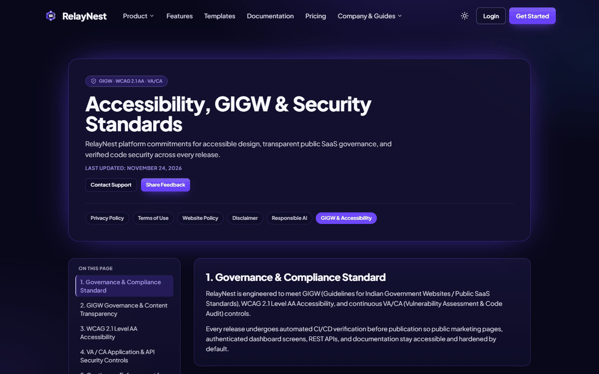 |

<details>
<summary>View additional walkthrough GIFs (Auth Transitions, Bot Wizard, Templates, Model Catalog, Analytics, Settings)</summary>

| Auth & Onboarding | Create Bot Wizard | Bot Templates |
| :---: | :---: | :---: |
| 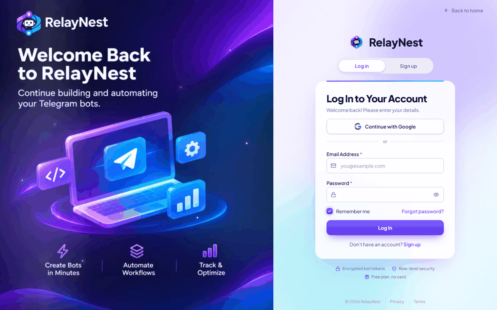 | 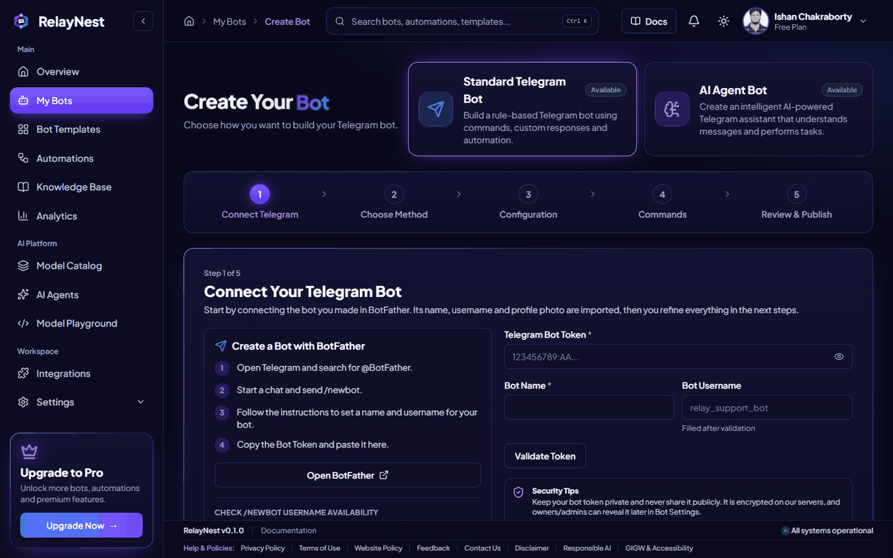 | 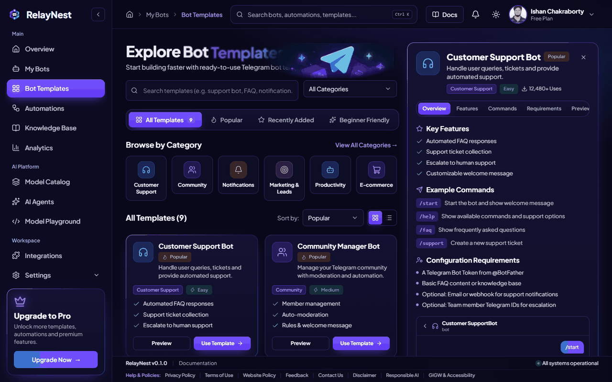 |
| **AI Model Catalog** | **Workspace Analytics** | **Workspace Settings & Plans** |
| 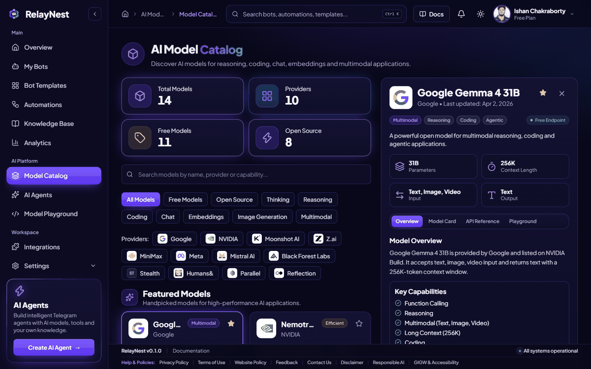 | 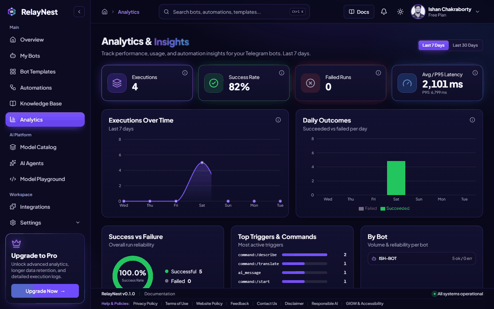 | 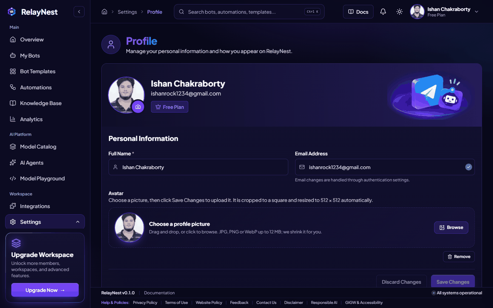 |

</details>

---

## Features

- **Telegram Bots & Two-Way Live Sync**: Connect bots with `@BotFather` tokens (encrypted at rest via `AES-256-GCM`), import Telegram avatars automatically, edit profile/commands/welcome/fallback replies in dedicated management tabs, cascade deletes directly to Telegram (`clear commands` + `deleteWebhook`), detect bots deleted inside Telegram (`telegram_deleted` badge), and track full Created & Deleted Bot History.
- **Ready-to-Use Templates & Guided Wizard**: Deploy Support, FAQ, Notification, Community, Lead Collection, or AI Assistant bots in minutes.
- **Visual Workflow Automations**: Drag-and-drop React Flow (`@xyflow/react`) builder with triggers, conditional branches, delays, SSRF-protected outbound HTTP requests, cron scheduling (`POST /api/cron/tick`), simulation test runs, and live execution history.
- **AI Platform & Knowledge Base RAG**: Browse models (`NVIDIA Build` + `Vercel AI Gateway`), test prompts live in Model Playground, upload PDF/text/URL Knowledge Base sources (keyword search or Milvus/Zilliz vector retrieval), and launch autonomous 24/7 Telegram AI Agents.
- **Integrations, Scoped API Keys & In-App Swagger UI**: Generate SHA-256 hashed production Bearer keys (`rnk_live_...`) with permission scopes and expiry windows, test endpoints live inside the authenticated Swagger UI (`/api-docs`), configure Slack/Discord/HTTPS outbound webhooks (`X-RelayNest-Signature` HMAC-SHA256) and signed incoming webhook triggers (`POST /api/webhooks/workflows/[publicId]`), and view 7-day request telemetry.
- **Real-Time Alerts, Billing & Platform Admin Console**: Instant notification bell + Brevo/Supabase Auth & account-deletion confirmation emails (`supabase/templates/` + `send-account-deleted` Edge Function), USD & INR plans (Subscriptions, Prepaid, Razorpay UPI QR), zero-trust Platform Admin Console (`/admin`) with Audit Trail, User Records, Live Service Health, Keys & Tokens, Console Logs, and Security Matrix.
- **Compliance & CyberSecurity Gate**: Built-in GIGW, WCAG 2.1 Level AA, VA/CA security scanner (`pnpm audit:compliance`) covering CSP, HSTS, anti-phishing URL/redirect guards, breached password rejection, sliding-window API rate limits (Upstash Redis), and app/docs version lockstep.

## Tech Stack

| Area | Choice |
| --- | --- |
| Web App & API | Next.js 15 (App Router, Turbopack), React 19, TypeScript strict |
| Styling & UI | Tailwind CSS 4, Lucide icons, Recharts, React Flow (`@xyflow/react`), Custom ARIA Select/Modals |
| Auth & Data | Supabase (Auth SSR + PKCE, Postgres + RLS, Storage Buckets) |
| Messaging & Cache | Telegram Bot API, Upstash Redis REST (Rate Limits & Idempotency), Upstash Kafka REST |
| AI & Vector RAG | NVIDIA Build, Vercel AI Gateway, `unpdf`, Zilliz Cloud / Milvus |
| Billing & Email | Razorpay (Checkout, Subscriptions, UPI QR webhooks), Brevo HTTP API + Auth SMTP |
| Hosting Targets | Cloudflare Workers (OpenNext) / Cloudflare Pages / Vercel / Render |
| Testing & Audit | Node `--test` with `tsx` (`84` tests), ESLint, TypeScript, `pnpm audit:compliance`, Remotion |

## Getting Started

```bash
# 1. Install (Node >= 26, pnpm >= 10)
pnpm install

# 2. Configure local environment
cp .env.example .env        # fill in Supabase + ENCRYPTION_KEY (see docs/PRODUCTION_AND_CICD_ENV.md)

# 3. Apply all SQL files in supabase/migrations/ in numeric order (via Supabase SQL Editor or CLI)

# 4. Run web app (UI + API routes) and backend supervisor together
pnpm dev
```

Open `http://localhost:3000` (if port `3000` is held by another local service on your machine, `scripts/dev-web.mjs` logs a notice and opens on the next free port automatically). With no Supabase values configured, run **`pnpm dev:demo`** for instant sample-data exploration.

Generate the 32-byte hex `ENCRYPTION_KEY` (and optional `CRON_SECRET` / `KAFKA_CONSUMER_SECRET`):

```bash
node -e "console.log(require('crypto').randomBytes(32).toString('hex'))"
```

### Scripts

| Command | What it does |
| --- | --- |
| `pnpm dev` | Starts Next.js (`scripts/dev-web.mjs` targeting `:3000`, fallback `:3001`) + backend test supervisor |
| `pnpm dev:3000` | Binds Next.js strictly on IPv4 `http://127.0.0.1:3000` when another app holds IPv6 `:::3000` |
| `pnpm dev:web` | Starts web app + API route handlers only |
| `pnpm dev:backend` | Validates `.env`, probes Supabase schema, watches backend tests |
| `pnpm dev:demo` | Starts app in demo mode on `:3300` (no credentials needed) |
| `pnpm audit:compliance` | Runs GIGW, WCAG 2.1 AA, VA/CA security, and version lockstep CI gate |
| `pnpm lint` | ESLint across `frontend/src`, `backend/src`, `backend/tests` |
| `pnpm typecheck` | Strict TypeScript check across frontend and backend |
| `pnpm test` | Runs all backend unit tests (`tsx --test`) |
| `pnpm build` / `pnpm start` | Production build and Node server |
| `pnpm images` | Regenerates optimized WebP/PNG assets in `frontend/public` |
| `pnpm emails` | Compiles synced branded HTML templates into `supabase/templates/` using Supabase Storage logo URL |
| `pnpm emails:logo` | Uploads `logo-icon-128.png` into public Supabase Storage `brand` bucket for emails |
| `pnpm auth:config` | Configures Supabase Auth SMTP (Brevo), Google OAuth, redirect URLs & templates |

## Repository Layout

```text
relaynest/
├── frontend/            Next.js 15 App Router pages, UI components, API route handlers, public media/video
├── backend/             Server logic imported by Next route handlers (services, repositories, crypto, security, tests)
├── supabase/            SQL migrations (20260101000000 .. 20260101001400), branded HTML email templates & Edge Functions
├── docs/                Architecture, PRD, API specs, Production/CI/CD deployment guides & compliance rules
├── scripts/             Dev server wrapper, compliance scanner, email builder, admin seed & Supabase scripts
├── video/               Remotion 4 product demo video project (compiles to frontend/public/video/)
└── .github/workflows/   GitHub Actions CI compliance + test + build + Cloudflare deployment pipeline
```

## Documentation & Deployment

- **Full Production URLs & Environment Matrix (GitHub, Supabase, Cloudflare Pages, Vercel, Cloudflare Workers, Render, Redis & Kafka)**: **[`docs/PRODUCTION_AND_CICD_ENV.md`](docs/PRODUCTION_AND_CICD_ENV.md)**
- Documentation Index: [docs/README.md](docs/README.md)
- Key Engineering Specs: [Architecture](docs/ARCHITECTURE.md) | [Database & RLS](docs/DATABASE_SCHEMA.md) | [API Spec](docs/API_SPEC.md) | [Integrations Setup](docs/INTEGRATIONS_SETUP.md) | [Cloudflare Deployment](docs/DEPLOYMENT.md) | [GIGW / WCAG / VA-CA Guidelines](docs/GIGW_VACA_ACCESSIBILITY.md) | [Security](docs/SECURITY.md)

## Security & License

Please report vulnerabilities privately per [SECURITY.md](SECURITY.md). Never commit `.env` or `.dev.vars`. Licensed under [MIT](LICENSE).
